# Entity-Relationship (ER) Diagram & Data Modeling

## 1. ER Modeling Overview

The API Sentinel relational data model consists of **9 core entities** organized into three functional layers:
1. **Multi-Tenant Identity & Access Management (IAM)**: `User`, `Organization`, `OrganizationMember`
2. **API Observability & Operational Incident Tracking**: `APIEndpoint`, `HealthCheck`, `Incident`, `APIVersion`, `Integration`
3. **Microservice Dependency Graph & AI Diagnostics**: `Service`, `ServiceDependency`, `DiagnosticReport`

---

## 2. Visual Entity-Relationship Diagram (Crow's Foot Notation)

```mermaid
erDiagram
    users ||--o{ organization_members : "belongs to (1:N)"
    organizations ||--o{ organization_members : "has members (1:N)"
    organizations ||--o{ api_endpoints : "scopes (1:N)"
    organizations ||--o{ services : "owns (1:N)"
    users ||--o{ api_endpoints : "registers (1:N)"

    api_endpoints ||--o{ health_checks : "records probes (1:N)"
    api_endpoints ||--o{ incidents : "triggers (1:N)"
    api_endpoints ||--o{ api_versions : "versions (1:N)"
    api_endpoints ||--o{ integrations : "consumed by (1:N)"
    api_endpoints ||--o{ services : "linked to (1:N)"
    api_endpoints ||--o{ diagnostic_reports : "diagnosed in (1:N)"

    services ||--o{ service_dependencies : "as provider (1:N)"
    services ||--o{ service_dependencies : "as consumer (1:N)"

    users {
        string id PK "cuid()"
        string name "Full Name"
        string email UK "Unique Email Address"
        string passwordHash "Bcrypt hashed password"
        datetime createdAt "Creation Timestamp"
        datetime updatedAt "Last Update Timestamp"
    }

    organizations {
        string id PK "cuid()"
        string name "Workspace Organization Name"
        string slug UK "URL-safe unique identifier"
        datetime createdAt "Creation Timestamp"
        datetime updatedAt "Last Update Timestamp"
    }

    organization_members {
        string id PK "cuid()"
        string organizationId FK "references organizations(id)"
        string userId FK "references users(id)"
        string role "OWNER | ADMIN | MEMBER"
        datetime createdAt "Joined Timestamp"
    }

    api_endpoints {
        string id PK "cuid()"
        string name "Service Name"
        string url "Target Probe URL"
        string method "HTTP Method (GET, POST, etc.)"
        string description "Service purpose"
        boolean isActive "Active monitoring flag"
        int interval "Probe frequency in seconds"
        int timeout "Request timeout in ms"
        int expectedStatus "Expected HTTP status code"
        int failureThreshold "Consecutive failures to trigger incident"
        string headers "Encrypted custom headers JSON"
        string organizationId FK "references organizations(id)"
        string userId FK "references users(id)"
        datetime createdAt "Registration Timestamp"
        datetime updatedAt "Last Update Timestamp"
    }

    health_checks {
        string id PK "cuid()"
        string endpointId FK "references api_endpoints(id) ON DELETE CASCADE"
        int statusCode "Observed HTTP status code"
        int latency "Round-trip latency in ms"
        boolean isHealthy "Probe health outcome"
        string errorMessage "Failure reason if unhealthy"
        datetime checkedAt "Probe Execution Timestamp"
    }

    incidents {
        string id PK "cuid()"
        string endpointId FK "references api_endpoints(id) ON DELETE CASCADE"
        string title "Incident title"
        string description "Failure diagnosis context"
        string status "OPEN | ACKNOWLEDGED | RESOLVED"
        string severity "CRITICAL | HIGH | MEDIUM"
        int occurrenceCount "Deduplicated consecutive failure counter"
        datetime lastFailureAt "Latest probe failure timestamp"
        datetime acknowledgedAt "User acknowledgment timestamp"
        datetime createdAt "Incident Opened Timestamp"
        datetime resolvedAt "Incident Resolved Timestamp"
    }

    api_versions {
        string id PK "cuid()"
        string endpointId FK "references api_endpoints(id) ON DELETE CASCADE"
        string version "Semantic Version (e.g. v1.0.0)"
        string title "Contract title"
        string format "JSON | YAML"
        string specHash "SHA-256 hash for deduplication"
        text specification "Full OpenAPI Specification Schema"
        datetime createdAt "Upload Timestamp"
    }

    integrations {
        string id PK "cuid()"
        string endpointId FK "references api_endpoints(id) ON DELETE CASCADE"
        string consumerName "Consuming application name"
        string serviceType "frontend | microservice | mobile | third-party"
        string contactEmail "Team alerting email"
        string environment "production | staging | development"
        string criticality "CRITICAL | HIGH | MEDIUM | LOW"
        datetime createdAt "Creation Timestamp"
        datetime updatedAt "Last Update Timestamp"
    }

    services {
        string id PK "cuid()"
        string name UK "Unique service identifier"
        string description "Service responsibility"
        string criticality "CRITICAL | HIGH | MEDIUM | LOW"
        string ownerTeam "Responsible engineering squad"
        string endpointId FK "references api_endpoints(id)"
        string organizationId FK "references organizations(id)"
        datetime createdAt "Creation Timestamp"
        datetime updatedAt "Last Update Timestamp"
    }

    service_dependencies {
        string id PK "cuid()"
        string providerId FK "references services(id) ON DELETE CASCADE"
        string consumerId FK "references services(id) ON DELETE CASCADE"
        string contractVersion "API version consumed"
        string notes "Integration details"
        datetime createdAt "Link Created Timestamp"
    }

    diagnostic_reports {
        string id PK "cuid()"
        string endpointId FK "references api_endpoints(id) ON DELETE SET NULL"
        string incidentId "Optional reference to incident"
        text query "Investigation prompt"
        string provider "LLM provider (e.g. nvidia-nim)"
        string model "Model identifier"
        text summary "Executive diagnostic summary"
        text verifiedFacts "JSON array of evidence facts"
        text hypotheses "JSON array of root-cause hypotheses"
        text recommendations "JSON array of actionable fixes"
        text evidenceContext "Sanitized telemetry snapshot"
        datetime createdAt "Report Timestamp"
    }
```

---

## 3. Relationships and Cardinalities

| Parent Entity | Child Entity | Relationship Type | Cardinality | Participation | Cascading Behavior | Business Rule |
| :--- | :--- | :--- | :--- | :--- | :--- | :--- |
| **Organization** | **OrganizationMember** | One-to-Many | `1 : N` | Total on Child | `ON DELETE CASCADE` | An organization contains one or more members. Deleting an org removes memberships. |
| **User** | **OrganizationMember** | One-to-Many | `1 : N` | Total on Child | `ON DELETE CASCADE` | A user can belong to multiple organizations with different roles (N:M junction). |
| **Organization** | **APIEndpoint** | One-to-Many | `1 : N` | Partial on Child | `ON DELETE CASCADE` | Endpoints are scoped to an organization for multi-tenant data isolation. |
| **User** | **APIEndpoint** | One-to-Many | `1 : N` | Partial on Child | `ON DELETE SET NULL` | Tracks the registering author. If user is deleted, endpoint remains active. |
| **APIEndpoint** | **HealthCheck** | One-to-Many | `1 : N` | Partial on Parent | `ON DELETE CASCADE` | High-frequency telemetry log. Deleting an endpoint deletes all historical probes. |
| **APIEndpoint** | **Incident** | One-to-Many | `1 : N` | Partial on Parent | `ON DELETE CASCADE` | Opened on probe failures. Deleting an endpoint cascades to its incident history. |
| **APIEndpoint** | **APIVersion** | One-to-Many | `1 : N` | Partial on Parent | `ON DELETE CASCADE` | Versioned OpenAPI specifications for semantic diffing. |
| **APIEndpoint** | **Integration** | One-to-Many | `1 : N` | Partial on Parent | `ON DELETE CASCADE` | External consuming apps mapped to an endpoint for blast-radius alerting. |
| **Service** | **ServiceDependency** (Provider) | One-to-Many | `1 : N` | Partial on Parent | `ON DELETE CASCADE` | Directed dependency edge: Provider service exposes APIs consumed by other services. |
| **Service** | **ServiceDependency** (Consumer) | One-to-Many | `1 : N` | Partial on Parent | `ON DELETE CASCADE` | Directed dependency edge: Consumer service calls upstream provider. |
| **APIEndpoint** | **DiagnosticReport** | One-to-Many | `1 : N` | Partial on Both | `ON DELETE SET NULL` | AI investigation snapshots remain archived even if the original endpoint is modified. |

---

## 4. Comprehensive Data Dictionary

### Table 1: `users`
| Column | Data Type | Constraints | Description |
| :--- | :--- | :--- | :--- |
| `id` | `VARCHAR(30)` | `PRIMARY KEY` | Unique CUID identifier. |
| `name` | `VARCHAR(100)` | `NOT NULL` | Developer's full name. |
| `email` | `VARCHAR(255)` | `NOT NULL, UNIQUE` | User email address used for JWT authentication. |
| `passwordHash` | `VARCHAR(255)` | `NULLABLE` | Bcrypt cryptographic password hash (salt rounds: 10). |
| `createdAt` | `TIMESTAMP(3)` | `NOT NULL, DEFAULT NOW()` | Account creation timestamp. |
| `updatedAt` | `TIMESTAMP(3)` | `NOT NULL` | Last profile update timestamp. |

### Table 2: `organizations`
| Column | Data Type | Constraints | Description |
| :--- | :--- | :--- | :--- |
| `id` | `VARCHAR(30)` | `PRIMARY KEY` | Unique CUID identifier. |
| `name` | `VARCHAR(100)` | `NOT NULL` | Workspace or company name. |
| `slug` | `VARCHAR(100)` | `NOT NULL, UNIQUE` | URL-safe slug for tenant routing. |
| `createdAt` | `TIMESTAMP(3)` | `NOT NULL, DEFAULT NOW()` | Organization creation timestamp. |
| `updatedAt` | `TIMESTAMP(3)` | `NOT NULL` | Last modification timestamp. |

### Table 3: `organization_members`
| Column | Data Type | Constraints | Description |
| :--- | :--- | :--- | :--- |
| `id` | `VARCHAR(30)` | `PRIMARY KEY` | Unique CUID identifier. |
| `organizationId` | `VARCHAR(30)` | `NOT NULL, FK` | References `organizations(id)` on delete cascade. |
| `userId` | `VARCHAR(30)` | `NOT NULL, FK` | References `users(id)` on delete cascade. |
| `role` | `VARCHAR(20)` | `NOT NULL, DEFAULT 'MEMBER'` | Role-based permission: `OWNER`, `ADMIN`, `MEMBER`. |
| `createdAt` | `TIMESTAMP(3)` | `NOT NULL, DEFAULT NOW()` | Timestamp when user joined organization. |
| *Composite Unique* | — | `UNIQUE(organizationId, userId)` | Prevents duplicate memberships in the same workspace. |

### Table 4: `api_endpoints`
| Column | Data Type | Constraints | Description |
| :--- | :--- | :--- | :--- |
| `id` | `VARCHAR(30)` | `PRIMARY KEY` | Unique CUID identifier. |
| `name` | `VARCHAR(150)` | `NOT NULL` | Human-readable service endpoint name. |
| `url` | `VARCHAR(2048)` | `NOT NULL` | Full target HTTP(S) URL. |
| `method` | `VARCHAR(10)` | `NOT NULL, DEFAULT 'GET'` | HTTP method (`GET`, `POST`, `PUT`, `DELETE`, etc.). |
| `description` | `TEXT` | `NULLABLE` | Detailed description of API functionality. |
| `isActive` | `BOOLEAN` | `NOT NULL, DEFAULT true` | Flag enabling/disabling active background probing. |
| `interval` | `INTEGER` | `NOT NULL, DEFAULT 60` | Probe frequency in seconds (e.g. 30, 60, 300). |
| `timeout` | `INTEGER` | `NOT NULL, DEFAULT 5000` | HTTP request timeout in milliseconds. |
| `expectedStatus`| `INTEGER` | `NOT NULL, DEFAULT 200` | Target HTTP status code considered healthy. |
| `failureThreshold`| `INTEGER` | `NOT NULL, DEFAULT 3` | Consecutive failures required before opening incident. |
| `headers` | `TEXT` | `NULLABLE` | AES-256-GCM encrypted JSON string of custom request headers. |
| `organizationId`| `VARCHAR(30)` | `NULLABLE, FK` | References `organizations(id)` on delete cascade. |
| `userId` | `VARCHAR(30)` | `NULLABLE, FK` | References `users(id)` on delete set null. |
| `createdAt` | `TIMESTAMP(3)` | `NOT NULL, DEFAULT NOW()` | Registration timestamp. |
| `updatedAt` | `TIMESTAMP(3)` | `NOT NULL` | Last configuration update timestamp. |

### Table 5: `health_checks`
| Column | Data Type | Constraints | Description |
| :--- | :--- | :--- | :--- |
| `id` | `VARCHAR(30)` | `PRIMARY KEY` | Unique CUID identifier. |
| `endpointId` | `VARCHAR(30)` | `NOT NULL, FK` | References `api_endpoints(id)` on delete cascade. |
| `statusCode` | `INTEGER` | `NULLABLE` | Observed HTTP status code returned by target server. |
| `latency` | `INTEGER` | `NULLABLE` | Round-trip request execution latency in milliseconds. |
| `isHealthy` | `BOOLEAN` | `NOT NULL` | True if statusCode == expectedStatus and within timeout. |
| `errorMessage`| `TEXT` | `NULLABLE` | Error description if request timed out, threw DNS or 5xx. |
| `checkedAt` | `TIMESTAMP(3)` | `NOT NULL, DEFAULT NOW()` | Execution timestamp (indexed for time-series range scans). |

### Table 6: `incidents`
| Column | Data Type | Constraints | Description |
| :--- | :--- | :--- | :--- |
| `id` | `VARCHAR(30)` | `PRIMARY KEY` | Unique CUID identifier. |
| `endpointId` | `VARCHAR(30)` | `NOT NULL, FK` | References `api_endpoints(id)` on delete cascade. |
| `title` | `VARCHAR(255)` | `NOT NULL` | Summary of failure cause (e.g. HTTP 503 Outage). |
| `description` | `TEXT` | `NULLABLE` | Technical failure diagnostics and timeline. |
| `status` | `VARCHAR(20)` | `NOT NULL, DEFAULT 'OPEN'`| State machine status: `OPEN`, `ACKNOWLEDGED`, `RESOLVED`. |
| `severity` | `VARCHAR(20)` | `NOT NULL, DEFAULT 'HIGH'`| Operational priority: `CRITICAL`, `HIGH`, `MEDIUM`. |
| `occurrenceCount`| `INTEGER` | `NOT NULL, DEFAULT 1` | Counter for deduplicated consecutive failure probes. |
| `lastFailureAt`| `TIMESTAMP(3)` | `NOT NULL, DEFAULT NOW()` | Timestamp of most recent failure probe. |
| `acknowledgedAt`| `TIMESTAMP(3)` | `NULLABLE` | Timestamp when on-call acknowledged the outage. |
| `createdAt` | `TIMESTAMP(3)` | `NOT NULL, DEFAULT NOW()` | Timestamp incident was first detected. |
| `resolvedAt` | `TIMESTAMP(3)` | `NULLABLE` | Timestamp when auto-recovery or manual resolution occurred. |

### Table 7: `api_versions`
| Column | Data Type | Constraints | Description |
| :--- | :--- | :--- | :--- |
| `id` | `VARCHAR(30)` | `PRIMARY KEY` | Unique CUID identifier. |
| `endpointId` | `VARCHAR(30)` | `NOT NULL, FK` | References `api_endpoints(id)` on delete cascade. |
| `version` | `VARCHAR(50)` | `NOT NULL` | Version identifier (e.g. "1.0.0", "2.1.0"). |
| `title` | `VARCHAR(150)` | `NULLABLE` | Descriptive specification title. |
| `format` | `VARCHAR(10)` | `NOT NULL, DEFAULT 'JSON'`| Schema serialization format: `JSON` or `YAML`. |
| `specHash` | `VARCHAR(64)` | `NULLABLE` | SHA-256 hash of canonical spec to prevent duplicate uploads. |
| `specification`| `TEXT` | `NOT NULL` | Raw OpenAPI 3.0/3.1 contract specification. |
| `createdAt` | `TIMESTAMP(3)` | `NOT NULL, DEFAULT NOW()` | Upload timestamp. |

### Table 8: `integrations`
| Column | Data Type | Constraints | Description |
| :--- | :--- | :--- | :--- |
| `id` | `VARCHAR(30)` | `PRIMARY KEY` | Unique CUID identifier. |
| `endpointId` | `VARCHAR(30)` | `NOT NULL, FK` | References `api_endpoints(id)` on delete cascade. |
| `consumerName` | `VARCHAR(150)` | `NOT NULL` | Name of downstream client (e.g. "Checkout Mobile App"). |
| `serviceType` | `VARCHAR(50)` | `NOT NULL, DEFAULT 'frontend'`| Service category (`frontend`, `microservice`, `mobile`, `third-party`). |
| `contactEmail` | `VARCHAR(255)` | `NULLABLE` | Point of contact email for incident alerting. |
| `environment` | `VARCHAR(50)` | `NOT NULL, DEFAULT 'production'`| Deployment target (`production`, `staging`, `development`). |
| `criticality` | `VARCHAR(20)` | `NOT NULL, DEFAULT 'HIGH'`| Service importance: `CRITICAL`, `HIGH`, `MEDIUM`, `LOW`. |
| `createdAt` | `TIMESTAMP(3)` | `NOT NULL, DEFAULT NOW()` | Integration registration timestamp. |
| `updatedAt` | `TIMESTAMP(3)` | `NOT NULL` | Last update timestamp. |

### Table 9: `services` & `service_dependencies`
| Table | Column | Data Type | Constraints | Description |
| :--- | :--- | :--- | :--- | :--- |
| `services` | `id` | `VARCHAR(30)` | `PRIMARY KEY` | Unique CUID identifier. |
| `services` | `name` | `VARCHAR(100)` | `NOT NULL, UNIQUE` | Service name across topology. |
| `services` | `description` | `TEXT` | `NULLABLE` | Architectural role. |
| `services` | `criticality` | `VARCHAR(20)` | `NOT NULL, DEFAULT 'MEDIUM'`| Priority level (`CRITICAL`, `HIGH`, etc.). |
| `services` | `ownerTeam` | `VARCHAR(100)` | `NULLABLE` | Team responsible for service. |
| `services` | `endpointId` | `VARCHAR(30)` | `NULLABLE, FK` | References `api_endpoints(id)` on delete set null. |
| `services` | `organizationId`| `VARCHAR(30)` | `NULLABLE, FK` | References `organizations(id)` on delete cascade. |
| `service_dependencies`| `id` | `VARCHAR(30)` | `PRIMARY KEY` | Unique CUID identifier. |
| `service_dependencies`| `providerId` | `VARCHAR(30)` | `NOT NULL, FK` | Upstream provider service (`services.id`). |
| `service_dependencies`| `consumerId` | `VARCHAR(30)` | `NOT NULL, FK` | Downstream dependent service (`services.id`). |
| `service_dependencies`| `contractVersion`| `VARCHAR(50)` | `NULLABLE` | Version consumed. |
| `service_dependencies`| `notes` | `TEXT` | `NULLABLE` | Integration notes and dependency details. |
| *Composite Unique* | — | — | `UNIQUE(providerId, consumerId)` | Prevents duplicate edges between the same two services. |
